<!--
  🥀 Todas as artes deste perfil são geradas por scripts/artes.mjs.
  Frases, estante, diário e tecnologias ficam no bloco CONFIG, no começo desse arquivo.
  Tema: "rosa-negra" (outros temas em modelos/README.md).
-->


<i>“To become spring means accepting the risk of winter.”</i> · Antoine de Saint-Exupéry


Estudo **Ciência da Computação** na **Universidade Federal de Alfenas (UNIFAL-MG)**. O que mais me encanta na computação é o design: pensar em como as coisas parecem, como é usá-las e o que elas fazem a gente sentir. Interfaces e jogos são o lugar onde código e arte se encontram, e é ali que eu gosto de ficar.

Longe do editor, eu desenho, jogo e visito cafés. Meus jogos favoritos contam histórias com a própria arte, como *Alice: Madness Returns*, *Spiritfarer*, *Gris* e *The Last of Us*. No cinema, prefiro o estranho, o hipnótico e o perturbador: *Climax*, *Enter the Void*, *Possessor*, *Nope*, *Bugonia*, *House* e *A Bruxa*, que é praticamente a alma deste perfil.







**Bacharelado em Ciência da Computação** · Universidade Federal de Alfenas (UNIFAL-MG)




As artes acima são geradas por código (<a href="./scripts/artes.mjs">scripts/artes.mjs</a>) e despertam todo dia à meia-noite por um GitHub Action.

